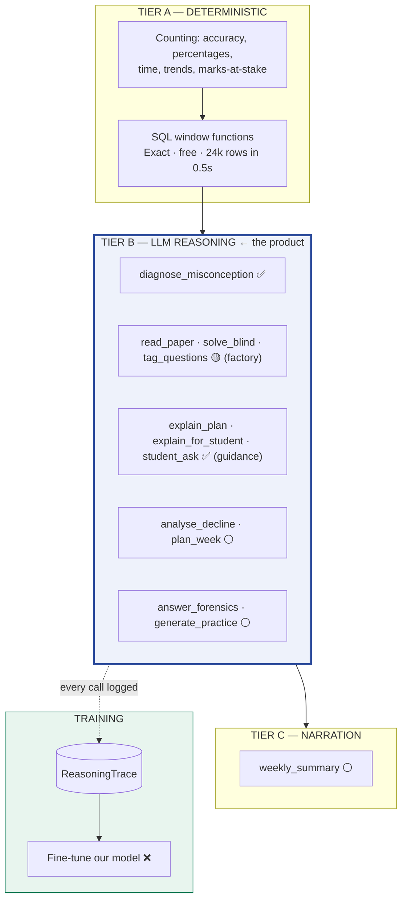
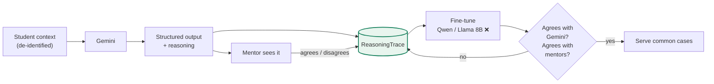
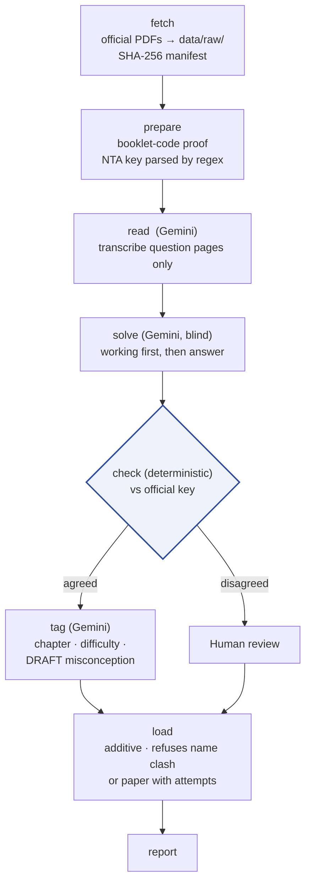
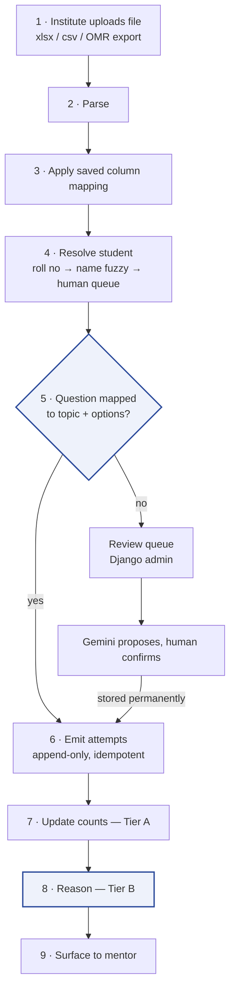
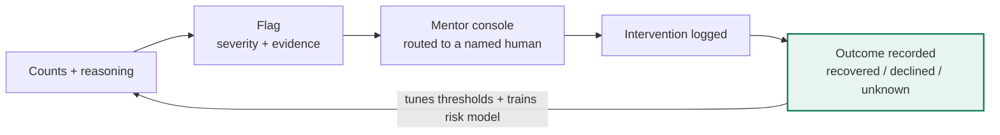

# Student AI — Technical Specification

**v3.1 · 24 Oct 2026**
Entry point: [`README.md`](README.md) · Next steps: [`TASKS.md`](TASKS.md) · History: [`PROJECT_LOG.md`](PROJECT_LOG.md) · Data shelves: [`data/README.md`](data/README.md)

> **v3.0 re-baselines v2.0 (25 Sep) against the code.** The reasoning thesis in v2.0 held up and is kept. What changed is the *state of the build*: the content blocker is gone, the first Tier B task is live, a question factory exists, and the console talks to the real API. Every status claim below was checked against the code on 10 Oct. Figures taken from the dev database are marked *(dev DB, 10 Oct)* and will drift.
>
> **v3.1 (24 Oct)** records the third build round: revisions scheduled automatically, a first forgetting model, one nightly job that runs every engine, onboarding answers that feed the planner, a planner that makes hard days lighter, guidance for students, Excel uploads, a person tagging an institute paper's wrong options, a review queue for answer-key disagreements, NEET's own subjects everywhere, and the tools a pilot needs (backups, password rotation, a readiness check). §3, §5, §7, §8, §10, §12 and §14 changed.
>
> v2.0 consolidated and superseded `LLM_ARCHITECTURE.md`, `SYSTEM_DESIGN.md`, `WORKFLOW.md`, `AGENT_HANDOFF.md`, `architecture.html` and `build-plan.html`. Those are deleted. Where any surviving note disagrees with this document, this document wins.

**Status legend:** ✅ built and working · 🟡 built, with a stated limit · ⚪ model/enum only, nothing runs it · ❌ not started

---

## 1 · What this is

A domain LLM for Indian competitive-exam preparation (JEE / NEET), sold to coaching institutes.

It ingests the mock-test results an institute already has and produces the judgement a good teacher makes when reading an answer sheet: **not what the student scored, but what they misunderstand, how much it costs them, and what to do about it.**

Every piece of reasoning Gemini does is logged, and those transcripts become the training set for our own fine-tuned model.

The buyer is the institute director, not the student. The built product is therefore led by a **director / mentor console**; since v3.1 there is also a **student app** (phone-first, on `/api/my/…`, §7 and §10) for the students the institute signs up.

### The correction from v1.0

v1.0 said *"the LLM narrates; it never computes."* Half right:

| | Verdict |
|---|---|
| Using an LLM to compute rolling accuracy | **Wrong then, wrong now.** Arithmetic over 24,000 rows — 12,480 API calls/day for a worse answer than a window function gives free. Stays deterministic. |
| Treating diagnosis, causal analysis and planning as "narration" | **That was the error.** These are judgement tasks. An LLM is the right tool; a rules engine is dramatically worse. Calling them narration mis-sized the product. |
| *"Distillation doesn't apply — labels are free"* | **Wrong.** True for knowledge tracing (right/wrong is ground truth). False for reasoning — there is no ground truth for *"what misconception does this pattern reveal?"* Gemini's traces **are** the signal. |

---

## 2 · The blocker, and what is left of it

On 25 Sep the whole reasoning layer was gated on input. We stored a question *ID* and a right/wrong flag, and nothing a model could reason about:

| Then (25 Sep) | Now |
|---|---|
| Question **text** — 0 of 525 populated | ✅ `QuestionTopicMap.question_text`, `solution`, `difficulty` |
| **Which option the student chose** — did not exist | ✅ `Attempt.chosen_option` |
| The **options** themselves | ✅ `QuestionOption` (label, text, `is_correct`) |
| What each **wrong option represents** | ✅ `QuestionOption.misconception` FK → `Misconception` |

The richest prompt we could build then was *"Student 4471 answered Q17 incorrectly. Topic: Rotational Motion. Time: 145s."* — from which no model produces anything but *"focus more on Rotational Motion."* With content it produces a falsifiable diagnosis (see §5). **The ceiling is the input, not the model** — that argument stands, and it is why §8 exists.

### What is still thin

| Gap | Detail |
|---|---|
| Student answers are **100% synthetic** | 24,000 `seed_demo` attempts plus ~2,000 diagnostic-paper attempts. Only the 4 "hero" students carry engineered error patterns. |
| Fully tagged content is **one 46-question paper** | The diagnostic paper has 63 FK-tagged distractors. The two real papers (255 questions) carry only *draft* misconception codes, unconfirmed by a person. |
| `seed_demo` mocks 8–14 have **no question text** | 7 papers × 75 questions: labels and right/wrong only. |
| Only **2,024 of 26,024** attempts carry a `chosen_option` *(dev DB, 10 Oct)* | Distractor analysis works only where those exist. |

The remaining blocker is no longer "no content" but **"real content, tagged by a person, on realistic students."**

---

## 3 · Three tiers



**The rule for deciding which tier something belongs to:**

> If the answer is a **number that must be exactly right and is computable by counting** → Tier A.
> If the answer is a **judgement a good teacher would make differently from a bad one** → Tier B.

Accuracy percentage is Tier A. *"Is this carelessness or a real gap?"* is Tier B.

**Tier A is not a constraint on Tier B — it is what makes Tier B credible.** The model reasons over exact numbers rather than inventing them, which is why its diagnoses can be checked against the record. No Tier A service ever calls an LLM.

> **Naming collision.** Each *detector* also declares a `tier` — there it means data need (0 = marks only, 1 = needs student-logged data). Unrelated to Tier A/B/C above.

### What Tier A actually computes ✅

| Quantity | Definition | Where |
|---|---|---|
| **Mastery** (per student × topic) | Decayed accuracy over the student's last 20 attempted questions in the topic, 30-day half-life, anchored to the pair's newest attempt. **Below 4 attempts it is NULL, not 0** — absence of evidence is not a gap | `derived/services/features.py` |
| **Retention** (per student × topic) | A forecast of recall, 0–1: `exp(−t / S)`. `t` is days since the chapter was last *seen* (newest attempt or completed revision); `S = 10 days × 2.5^cycles done (at most 3) × (0.5 + mastery)`, unknown mastery counting as a neutral 0.5. A chapter met once at middling mastery reaches even odds after ~7 days — the R2 interval — and its half-life after R1, R2, R3 is about 17, 43 and 108 days. **NULL when the chapter was never seen** (a study log alone does not count: it is self-reported). The constants are priors, not fitted: nothing yet records *how much* was remembered | `features.py` (`FEATURE_VERSION = rung0-v2`) |
| **Marks lost** | A wrong answer costs 5, a skip 4; cumulative across all papers | `features.py` |
| **`risk_score`** | **0–1** (not 0–100). Weights: decline 0.50 · subject imbalance 0.20 · inconsistency 0.20 · debt 0.10. A student is *at risk* at ≥ 0.55 | `features.py`, `api/views.py` |
| **Mock analysis** | Every lost mark is booked to one of **five causes**: `conceptual_gap` (wrong, mastery < 0.60) · `execution_error` (wrong, mastery ≥ 0.60) · `time_exhaustion` · `avoidable_skip` · `insufficient_evidence` (mastery unknown). Speed rule: > 2× the student's own median correct-answer time, needing ≥ 8 correct answers for a baseline | `events/services/mock_analysis.py` |
| **Recoverable marks** | The **sum of the three evidenced causes** (execution + time + skip) — *not* `total − conceptual_gap`. `insufficient_evidence` is deliberately excluded from both sides; an unmeasured chapter has been shown to be neither a gap nor recoverable | `mock_analysis.py` |

`recompute_features` rebuilds mastery, retention and student state; `run_detectors` raises flags. Both are still commands, and both now run **every night** as steps of `run_nightly` (§10).

---

## 4 · Misconception taxonomy — the actual IP

A **misconception** is a systematic wrong belief that produces *predictable* wrong answers. Not carelessness — a stable, wrong mental model.

Every wrong option on every (fully tagged) question carries the misconception that produces it. *Illustrative only — the rod question below is a teaching example; `MIS-ROT-DISC` and `MIS-ROT-POINT` are not codes in the taxonomy:*

```
Q17. A uniform rod of mass M, length L rotates about one end…
  (A) ML²/3    ✓ correct
  (B) ML²/12   ✗ MIS-ROT-AXIS   — used the centre-of-mass axis
  (C) ML²/2    ✗ (disc formula)  — applied the disc formula to a rod
  (D) ML²      ✗ (point mass)    — treated it as a point mass
```

A real one, from the diagnostic paper (paper question `D16`):

```
Nitration of toluene with a HNO3/H2SO4 mixture gives predominantly:
  (B) o- and p-nitrotoluene    ✓ correct
  (C) m-nitrotoluene           ✗ MIS-ORG-EAS — activating group sends the incoming group to meta
```

One student picking a distractor once is noise. **The same student picking the same misconception across several questions is a diagnosis** — evidenced, quantifiable in marks, and targetable with practice. It also makes the LLM's reasoning **falsifiable**: *"he has an axis-identification problem"* can be checked against the distractor record.

### Taxonomy — 15 codes ✅ (`ingestion/demo_questions.py`)

`Misconception.description` is written **in the student's voice, as the belief they hold**; `remedy` is a lesson a teacher can actually run. Both go straight into the model's prompt — they are what let it explain *why*.

| Code | Subject | The wrong belief |
|---|---|---|
| `MIS-ROT-AXIS` | Physics | Uses the tabulated (centre-of-mass) axis when rotation is about another point |
| `MIS-ROT-SHAPE` | Physics | Treats the standard moment-of-inertia results as one interchangeable family |
| `MIS-SIGN-FIELD` | Physics | Sign errors on field / force direction |
| `MIS-KIN-AVG` | Physics | Confuses average with instantaneous velocity / speed |
| `MIS-KIN-RELVEL` | Physics | Computes relative motion in the wrong frame |
| `MIS-ORG-EAS` | Chemistry | Directing effects reversed (activating group → meta) |
| `MIS-ORG-MARKOV` | Chemistry | Markovnikov vs anti-Markovnikov addition |
| `MIS-ORG-STABILITY` | Chemistry | Carbocation stability ordered by group size, not by effect |
| `MIS-EQM-CATALYST` | Chemistry | Believes a catalyst shifts equilibrium position |
| `MIS-BOND-COUNT` | Chemistry | Miscounts σ vs π bonds |
| `MIS-BOND-HYBRID` | Chemistry | Reads hybridisation off the formula ("carbon forms four bonds, so sp³") |
| `MIS-ALG-SQUARE` | Maths | Keeps roots gained by squaring both sides |
| `MIS-ALG-MODULUS` | Maths | Drops the sign cases of a modulus |
| `MIS-TRIG-DOMAIN` | Maths | Ignores domain / range restrictions on inverse trig |
| `MIS-CALC-CHAIN` | Maths | Drops the inner derivative in the chain rule |

### The taxonomy is already fragmenting on real papers ⚠

The factory (§8.1) asks Gemini to draft a misconception per wrong option. On the two real papers it proposed **"new" codes for 496 of 514 NEET distractors and 153 of 162 JEE distractors** — roughly 350 and 140 distinct draft codes *(from the extracted files, 10 Oct)*. These sit in `draft_misconception_*` fields; **only a person may set the real FK.** A consolidation pass (merge drafts into the 15-code vocabulary or promote the real new ones) is required before the taxonomy scales. Left alone, it stops being a vocabulary.

Built from our own data and cannot be bought — *if* it stays curated.

---

## 5 · Tier B reasoning tasks

Each is a defined job with **structured JSON output** — not an open chat prompt. Structure is what makes output checkable, storable, and usable as training data.

| Task | Input | Output | Status |
|---|---|---|---|
| `diagnose_misconception` | Wrong answers + the misconception each implies, counter-evidence | Ranked hypotheses, cited evidence, confidence, time-to-fix | ✅ **Live.** `GET /api/students/{id}/diagnosis/?paper=`; verified on all 4 hero students, correct misconception each time |
| `read_paper` | Official paper PDF (question pages only) | Transcribed questions + options | 🟡 Factory stage; `read-v1`, temperature 0 |
| `solve_blind` | Our transcription, *without* the official answer | The model's own answer, working first | 🟡 Factory stage; `solve-v3` |
| `tag_questions` | Question + options + syllabus | Chapter, difficulty, **draft** misconception per wrong option | 🟡 Factory stage; `tag-v2` |
| `explain_for_student` | A diagnosis **a mentor agreed with** | The same finding reworded for the student: title, explanation, what to do | ✅ Reworded by the nightly job (≤ 2 per student, ≤ 10 model requests per institute a night); `GET /api/my/guidance/` reads the cache only and otherwise shows fixed wording |
| `explain_plan` | The day's blocks and the reasons the planner wrote on them | Two or three sentences: why today looks like this | ✅ `POST /api/my/plan/explain/`; always 200, `available: false` = fixed wording |
| `student_ask` | A preparation question the student typed (≤ 500 chars, scrubbed) + their own numbers | A short answer about *preparation* | ✅ `POST /api/my/guidance/ask/`; 20 a day; 503 when the model is unreachable — no fallback, because there is no honest fixed answer to an arbitrary question |
| `analyse_decline` | Timeline: scores, time allocation, revision gaps, confidence | Causal narrative + the single highest-value intervention | ⚪ enum constant only |
| `plan_week` | Gaps, exam date, hours, class schedule, topic weights | Ordered plan, each block justified | ⚪ enum constant only |
| `answer_forensics` | Question + student's working | Where the reasoning broke; which misconception | ⚪ enum constant only |
| `generate_practice` | A confirmed misconception + difficulty | Questions whose distractors target that exact error | ⚪ enum constant only |
| `weekly_summary` | All of the above | Mentor- and parent-facing prose | ⚪ enum constant only (Tier C) |

> The day plan is **rules, not a model** (`derived/services/planner.py`, §7): `plan_week` is still unbuilt, and `explain_plan` only puts the rules' own reasons into sentences.

### Guidance for students — what the model is trusted with there

Four things, in order of how much the model does (`reasoning/services/guidance.py`):

1. **`next_actions`** — no model at all. Rules over the student's own data (a plan to start, revisions due, marks recoverable on the last mock, a weak chapter, no study logged for 3 days, a chapter never rated), at most 5, each with a `target` screen.
2. **`findings`** — only a diagnosis whose trace a mentor marked *agreed*. The model rewords; it does not judge. Unreviewed and disagreed diagnoses are never read. **The rewording is done by the nightly job, never inside the student's request**: the student's `GET` reads the cache only and, until a finding has been reworded, shows it in fixed wording at once. (Found on 25 Oct: done live, three overlapping page loads each reworded the same finding, taking 40, 66 and 107 s, and the app's home screen waited on them.)
3. **`explain_plan`** — the planner's reasons, as prose.
4. **`answer_question`** — the only free text from a minor that reaches the model. It is **scrubbed first** (`redact.py`: the student's name, roll number, institute, mentor, phone numbers and emails are replaced at any depth of the payload), answered under a system prompt that declines to solve exam questions, and limited to 20 a day.

A message about self-harm is caught before any of this: a fixed, kind reply that points to the student's mentor or a trusted adult. It is not sent to the model, writes no trace, and is not throttled. **It does not alert anyone** — whether it should, and whom, is a decision for the institute and the pilot agreement (TASKS.md). Every guidance call has a 15-minute cool-down after a failure, so a reload during an outage does not walk the model chain again.

### What the diagnosis response carries beyond the model's text

The reasoning call is untouched; `present()` re-presents data the trace already stores, so a replayed diagnosis shows exactly what it was made from. Four additions: `student_ref` (the `S-{id}` pseudonym the model saw, so the privacy claim can be read off the response); `tally` (the deterministic counts the model was handed — every wrong answer, not only the cited ones — so its story can be held against the arithmetic); `hypotheses[].counter_evidence_questions` (the correct answers the counter-evidence sentence names, resolved to routable question ids, but only from candidates the server itself derived, so the model can phrase the argument and cannot invent a question to cite); and `human_verdict` as a real three-value enum, where `unreviewed` is a value and not an absence.

### Privacy — non-negotiable

Users are minors, and Gemini's free tier may use submitted content for training, with human review. **PII is stripped before every call** and re-attached locally afterwards. The real payload (`diagnose.build_context`):

```json
{ "student_ref": "S-4471", "exam": "JEE_MAIN", "paper": "Mock 15 — Diagnostic",
  "wrong_answers":   [{"label": "D16", "stem": "...", "option_text": "...", "indicates": "MIS-ORG-EAS"}],
  "correct_answers": [...],
  "misconception_glossary":     {"MIS-ORG-EAS": {"description": "...", "remedy": "..."}},
  "marks_lost_by_pattern":      {"MIS-ORG-EAS": 25},
  "counter_evidence_by_pattern": {"MIS-ORG-EAS": [...]},
  "totals": {...} }
```

No name, roll number, phone, DOB or institute name ever leaves our system. A test asserts the payload for the hero student contains neither his name nor his roll number. Question stems are exam content, not PII.

### What the model is *not* trusted with

The model writes prose; Tier A re-owns anything countable. `present()` in `diagnose.py` runs after every call:

- **Citations are re-resolved server-side** against the student's own attempts to `{question_id, label, chose, marks_at_stake}`. `question_id: null` means the citation did not resolve — the console renders it as text, never as a link to nowhere. Hypotheses cannot overlap (one option per question, one misconception per option), so the total is a clean sum over distinct cited questions.
- **`marks_at_stake` is recomputed** as `5 × resolved citations`, not taken from the model. (`MARKS_PER_WRONG = 5` is hard-coded here, while the mock analyzer reads marks from the paper — see §12.)
- **`counter_evidence` is derived deterministically** and never blank: two different substituted sentences distinguish *"no counter-evidence on this paper"* from *"the model did not state it, treat this finding as un-narrowed."* A silence must not be reported as a finding.
- `ReasoningTrace.output` keeps the model's **raw JSON, untouched**. A training example that has been quietly corrected is not a training example.
- **Not validated:** the `misconception_code` the model chooses, its claim prose, and `time_to_fix`. These are exactly the fields a mentor's verdict is for.

### The Gemini client — what it guarantees ✅

- **Never fabricates.** No API key and no cached answer raises `NoCredentialsAndNoCache`; the endpoint returns a clean 503 in plain prose. There is deliberately no fallback that invents a diagnosis — fake AI output presented as real is the one failure this product could not survive.
- **Cache key = task + context hash + `prompt_version`.** `model` is deliberately excluded: a capacity fallback is incidental, not a change of intent. (An earlier key ignored `prompt_version`, so a v2 prompt would have kept serving v1 answers; fixed.)
- **A trace is written per attempt, failures included** — failures are training data too.
- **Model fallback chain, per task.** 404 / 429 / 5xx try the next model; 400 / 401 / 403 and invalid JSON stop. Quota is per model, so each task carries its own list.
- **Errors are prose for the reader.** 422 (`NoOptionsRecorded`, `NoMisconceptionTags`) and 503 bodies are written for a director reading over a mentor's shoulder; the technical string is logged, not shown.
- `documents.ask` (used by the factory) attaches PDFs and keys its cache on file SHA + page range.
- Tests are blocked from the network (`conftest.no_gemini_network`).

**Free-tier reality:** about **20 requests per model per day**, and 503 "busy" responses appear to count against it. Processing thousands of questions needs a small paid budget or batch mode.

---

## 6 · Training our own model



**`ReasoningTrace`** (`reasoning_reasoningtrace`, behind RLS) records per call: task type, exact input context, model + `prompt_version`, structured output, latency, **input and output token counts**, and **`human_verdict`** (`unreviewed` / `agreed` / `disagreed`).

Two corrections to v2.0: there is **no cost field** (tokens only), and the `reasoning` column exists but **nothing writes it** — the reasoning chain lives *inside* the structured output (`working` in `solve_blind`, `how_produced` in `tag_questions`).

`human_verdict` is what makes the corpus worth more than raw Gemini output: a mentor confirming a diagnosis converts a *teacher-model guess* into a *human-validated example*. `POST /api/students/{id}/diagnosis/verdict/` records it — but it stamps the student's **latest** diagnose trace, which is not necessarily the one on screen.

| Stage | Traces | What happens | Status |
|---|---|---|---|
| 1 · Collect | 0 → 5,000 | Gemini does everything; all logged | 🟡 **In progress.** 14 successful `diagnose` traces, 1 mentor-agreed *(dev DB, 10 Oct)*, plus one trace per factory call |
| 2 · Distil narrow | ~5,000 | Fine-tune on **one** task (`diagnose_misconception`) | ❌ No export, no harness |
| 3 · Evaluate | — | Agreement with Gemini on held-out cases, then with mentors (the real metric) | ❌ |
| 4 · Route | ~20,000 | Ours handles common cases; Gemini handles hard ones | ❌ |
| 5 · Widen | 50,000+ | More tasks, hardest last | ❌ |

**Not** training from scratch. Fine-tuning an existing open model on domain traces — a different and entirely achievable thing. ~5,000 traces is a long way off at 20 calls/model/day; the factory and `generate_practice` are the realistic volume sources.

---

## 7 · Data model

### The spine
`Exam → SyllabusVersion → Topic`, **versioned per institute** (two centres split chapters differently; a global tree does not survive the second customer). `Topic` is a self-referencing tree whose nodes have a `kind` of `subject`, `unit` or `chapter`. Every event references a chapter-level `topic_id`.

### Current tables — 26, built and working

| Group | Tables |
|---|---|
| Tenancy (5) | `User` · `Institute` · `Mentor` · `Batch` · `Student` *(+ `daily_minutes`, `target_rank`, `onboarded_at`)* |
| Syllabus (3) | `Exam` · `SyllabusVersion` · `Topic` *(+ `ncert_ref` JSON)* |
| Events, *append-only by convention* (5) | `Attempt` *(+ `chosen_option`)* · `StudyLog` · `ConfidenceRating` · `RevisionEvent` · `ChapterStatus` |
| Content & ingestion (6) | `TestPaper` *(+ provenance)* · `QuestionTopicMap` *(this is the question table; + `key_review*`)* · `QuestionOption` · `Misconception` · `IngestBatch` · `ColumnMappingProfile` |
| Derived (6) | `TopicState` · `StudentState` · `Flag` · `Intervention` · `PlanBlock` · `JobRun` *(the nightly receipt)* |
| Reasoning (1) | `ReasoningTrace` |

There is **no separate `Question` table**: `QuestionTopicMap` holds text, solution, difficulty, topic mapping and — for official papers — `official_answer`, `model_answer`, `nta_question_id` and `verification` (agreed / disagreed / unverifiable). `IngestBatch` and `ColumnMappingProfile` are written by the results upload (§8.2); an `IngestBatch` is the receipt for every attempt it created.

**Provenance.** `TestPaper.provenance` is `official_pyq` / `demo` / `generated`, with `source_ref`. The console and the "Data & trust" page use it to say what is real.

### Syllabus versions

| Version | Chapters | NCERT-linked | State |
|---|---|---|---|
| `JEE_MAIN` v1 | 56 | 0 | **Active.** A placeholder typed from memory; all demo batches are bound to it. 43 of 56 names correct, 9 of 12 unit groupings invented |
| `JEE_MAIN` v2 | 54 | 51 | Official 2026 (NTA PDFs, every chapter traced to a page). Inactive |
| `NEET_UG` v1 | 71 | 68 | Official 2026. Inactive. Botany/Zoology split is **not** stated by NTA — tagged by content (17) or coaching convention (14, flagged) |

**Chapter weights are not measured anywhere.** The official trees leave `weight` at the 1.0 default; the v1 placeholder's weights are guesses (4/8/12). Real weights are to be counted from past papers. Three chapters cannot link to NCERT: *p-Block Elements* (no chapter in any current book, still examined), *Experimental Skills*, *Practical Chemistry*.

**Subjects come from the syllabus.** `syllabus/services.subjects_for_student` (and `subjects_by_batch` for many students at once) reads a student's subjects from their batch's syllabus tree, in its own order; views, rollups, detectors (`subject_imbalance` v2) and the features' balance index all use it. A NEET batch has Physics, Chemistry, Botany and Zoology, and `mock-scores` carries a `subjects[]` list for every exam (the three named JEE fields stay, 0 when absent). Still true: seeders look up the active syllabus without an exam filter, and the 15-code taxonomy has no Biology codes, so a Biology option can only carry a *draft* misconception.

### Invariants — and how true they are today

| # | Invariant | Reality |
|---|---|---|
| 1 | **Event tables are append-only.** Corrections arrive as new rows; this is what lets us change the mastery model and replay history | 🟡 **Convention plus a read-only admin.** The DB role holds UPDATE/DELETE on every table, and `seed_demo --flush` deletes events |
| 2 | **Derived state is rebuildable from events alone** | 🟡 True for `TopicState` / `StudentState`, `retention` included (rebuild-tested; `recompute` is deterministic for a given `as_of`; `--rebuild` drops only these two). **Not** true for `Flag.outcome`, `resolved_at` and `Intervention` — human input — nor for `PlanBlock.completed` (a student's tick) or `JobRun` (a receipt) |
| 3 | **Syllabus versions are immutable** once events reference them | ⚠ **Not enforced.** `TopicAdmin` allows editing `weight` / `position` on any version |

### Tenant isolation — live and verified ✅

PostgreSQL row-level security, enforced by a non-superuser role (`student_ai_rls`) that `TenantMiddleware` switches into per request. The tenant column is `institute_id`.

```
institute 1 → 24,000 attempts        institute 2 → 0        (seed_demo alone)
unset setting → 0 rows (fails closed)
cross-tenant INSERT → refused
```

- 20 policies in `tenancy/0003`, plus `reasoning_reasoningtrace` in `reasoning/0002`. `manage.py rls_check` proves it.
- **Gap:** `ingestion_questionoption` has no institute column and no policy; its parent question is policed, and `rls_check` does not cover the option table.
- Django **superusers are not RLS-scoped** (`middleware.py`); `TenantScopedMixin` is the second layer, and a superuser must pass `?institute=`. Management jobs run unscoped as the `sai` superuser unless wrapped in `tenant_scope`.

> ⚠ **Two traps, both live.** The `sai` role in `DATABASE_URL` is SUPERUSER/BYPASSRLS, so `FORCE ROW LEVEL SECURITY` alone is insufficient and a naive RLS test **passes vacuously**. And `TenantMiddleware` reads `request.user` — if JWT/token auth is ever added, it silently stops scoping and must move into a DRF authentication class.

### Authentication ✅

Django **session cookie + CSRF**. Endpoints: `GET /api/auth/csrf/` · `POST /api/auth/login/` · `POST /api/auth/logout/` · `POST /api/auth/password/` · `GET /api/me/`. Role is derived from the user's link: `mentor` → mentor, `student` → student, else `is_staff` → director (`api/auth.py`). Pagination is 50 (max 200) per page, and 200 (max 500) for bulk routes.

**Student sign-in is roll number + a password the institute provides, and the first sign-in must change it.** `username` on the login form is a staff username *or a roll number*; one backend (`tenancy/auth_backends.py`) gathers the candidate accounts and the password decides which it was, because roll numbers are only unique per batch — a clash resolves to whichever student knows the password, and an optional institute code narrows it. Staff issue a login with `POST /api/students/{id}/account/` (a random `XXXX-XXXX` temporary password, returned once, `Cache-Control: no-store`, stored hashed) and replace it with `…/account/reset-password/`. They are two verbs on purpose: one "make sure they can sign in" call could overwrite a password a student had already chosen. Bulk onboarding is `manage.py provision_student_accounts`, because each account costs one password hash (~1 s) and a batch of sixty does not belong inside a web request.

**The forced change is enforced on the server.** While `User.must_change_password` is set, `PasswordChangeRequiredMiddleware` answers every `/api/` route except `auth/*` and `me/` with 403 `code: password_change_required`; the login screen is only the friendly half. `POST /api/auth/password/` needs the current password, runs Django's validators plus a rule against containing the roll number, keeps the session alive, and clears the flag. A reset sets it again and signs the student out everywhere.

**Throttles** (`ScopedRateThrottle`, opt-in per view): login 10/min per client, password change 5/min per account, credentials 30/h, student writes 120/h, plan generation 30/h, uploads 20/h, onboarding 30/h, guidance questions 20/day, plan explanations 30/day. Clients are identified by socket address (`NUM_PROXIES = 0`), never by an `X-Forwarded-For` header they wrote themselves. Not built, deliberately: per-account lockout, which would let anyone who knows a roll number lock that student out. The counters live in Django's default per-process cache — fine for one worker, and the thing to swap for a shared cache before running more than one.

### The engines that write derived state ✅

| Engine | What it does | Where |
|---|---|---|
| **Revision scheduler** | R1 the day after a chapter is first met (first study log, first attempt, or the day the batch was taught it), R2 7 days after R1 is *done*, R3 30 days after R2. A cycle nobody did is not followed by another — the backlog is the signal. Never after the exam (lands the day before instead), never into the past (due today instead), and no R1 for a chapter first met more than 7 days ago (on day one that would be forty revisions at once; the forgetting model covers old chapters). Append-only and idempotent; runs nightly and right after a student logs study or finishes a revision | `derived/services/revisions.py` |
| **Day planner** | Budget: the student's own `daily_minutes` (honoured from 45, capped at 360), else the median they log (floored at 90), else 180. Then blocks, in this order while the budget lasts: revisions due or overdue, then chapters whose forecast recall is below 50% (both *revise*); the weakest taught chapters with a measured mastery (*practice*), a neglected subject's first when an open `subject_imbalance` flag names one (`subject_balance`); then chapters taught but never attempted (*learn*). Each block carries the reason it was chosen. **Burnout guard:** an open `overload` flag cuts the day to 60% with nothing new; open `disengagement` caps it at 90 minutes. The plan then carries a gentle `note` that never names a flag, a detector or a risk. Untimed blocks; `target_rank` is recorded but unused — nothing links a rank to a day's work honestly | `derived/services/planner.py` |
| **Nightly job** | Per institute, inside `tenant_scope`: features → revisions → detectors → a plan for every active student (never replacing one they made) → rewording of mentor-approved findings for the students' guide (capped at 10 model requests). Steps 1–3 each in their own transaction; a failed step stops the later ones for that institute only. Leaves a `JobRun` receipt (`ok`/`failed`, with counts per step), which `GET /api/dashboard/summary/` reports as `last_refreshed_at` | `derived/services/nightly.py` |

### Two surfaces, and the wall between them ✅

The API has two surfaces, and a caller belongs to one:

- **`/api/my/…` — the student app.** Addressed by *account*, never by id: the student is whoever the session says, so there is no id to tamper with. Onboarding (`GET`/`PUT`: daily minutes 45–720 and an optional target rank; exam and batch are the institute's and read-only), guidance (`next_actions`, mentor-approved `findings`, `ask`), plan (`generate`, `complete`, `uncomplete`, `explain`), study log (read/append), confidence ratings (append), revisions (read, and `complete` once), `attempts` + `questions/{id}` (review my mistakes — the stem, my answer, the key and the working, but **not** the misconception behind a wrong option), and the read models — `profile`, `topics` (the pick-list, with NCERT links), `topic-states`, `mock-scores`, `subject-breakdown`, `marks-lost`. Computed by the same functions as the console's (`api/rollups.py`), so a student and their mentor never see different numbers. Not shown to a student: `risk_score`, flags, interventions, the misconception diagnosis — a product decision (see TASKS.md), and the one that can be reversed.
- **Everything else — the console.** Addressed by id and scoped to the *institute*. Closed to student accounts by `IsConsoleUser`.

The wall is not optional and RLS cannot provide it. A student and their classmates share an institute, so row-level security is satisfied on both sides of the fence: before `IsConsoleUser`, a student logged in could read any classmate's record, risk score and flags through `/api/students/{id}/`. That is broken object-level authorization (OWASP API1:2023), a different failure from a cross-tenant leak; `tests/test_student_api.py` pins it route by route. A revision's `done_at` is the one field in the event log written after insert, and only ever once (null → a time, by a conditional `UPDATE … WHERE done_at IS NULL`): the row says both *that* it happened and *when*, so replaying history still reproduces what happened, which is what the append-only rule is for. Writes by students are validated at the door: a chapter must belong to the student's own syllabus, `minutes` is 1–720, a study log cannot be dated in the future, and a confidence rating's timestamp is set by the server (the feature store takes the *latest* rating, so a client-set `ts` could pin one for ever).

---

## 8 · Content and ingestion

There are two ingestion problems. Both are built, at different depths: public papers go through the factory (§8.1), an institute's own results through an upload (§8.2).

### 8.1 · The question factory — official paper to tagged, checked questions ✅

**Rule: open book, not closed book.** The answer is always the official key. Gemini reads, solves and tags *from* official documents; it is never the source of a fact. (An LLM's memory of exam content is unreliable exactly where it matters — a live example: published sources disagreed on whether JEE Main numericals carry negative marking; the official bulletin settled it at −1.)



Run as `manage.py factory fetch|prepare|read|solve|check|tag|load|report|all|list` (`--max-calls`, `--force`, `--wait`, `--replace`). State is resumable JSON in `data/extracted/`, which — like `data/raw/` — is **not in git** (the GitHub repo is publicly readable).

Design points that matter:

- **The key is never the model's.** It is parsed by regex from NTA's key; a SHA-256 manifest check and a booklet-code proof (`structure.verify_booklet`) run with no model call.
- **Gemini sees only the question pages**, never the mirror's key pages — so the "blind" solve is blind.
- **Working before answer.** Gemini orders schema fields alphabetically, so the solver wrote its answer first and justified it after. Forcing `working` first took one model from 6/10 to 8/10.
- **LaTeX in JSON is corrupted** (`\theta` arrives as a tab) — 23 of 30 early questions — and is repaired deterministically.
- **Misconception drafts are drafts.** They land in `draft_misconception_*`; only a person sets the FK.

Results *(dev DB, 10 Oct)*:

| Paper | Questions | Agreed | Disagreed | Diagrams |
|---|---|---|---|---|
| JEE Main 2026 · 2 Apr · Shift 1 (official) | 75 | 66 (88.0%) | 9 | 8 |
| NEET UG 2025 · Code 45 | 180 | 157 (87.2%) | 23 | 24 |

**No official key was wrong.** Of the 32 disagreements, 2 were our *reading* errors (a square-root placement; options scrambled out of a 2×2 grid) — caught **only** because of the cross-check, and they would otherwise have shown wrong content to a director. The rest are the model solving wrongly, or figure questions to eyeball.

Limits to state plainly:
- **Agreement proves the question and its correct option — not every wrong option.** A spot-check found √ signs lost from two wrong options that still "agreed".
- **Sourcing:** the JEE paper and key are official NTA. NTA does not openly publish NEET papers, so the NEET paper is a Physics Wallah mirror; its booklet code was *proven* (matches NTA's code-45 key on 179 of 180; other codes at chance), not assumed.
- **The 32 disagreements now have a review queue** — `GET /api/review/disagreements/` and `POST …/{question_pk}/` with one of three decisions (`ingestion/services/review.py`). *Key stands* trusts the key like an agreed one; *key is wrong* and *unclear* make the question untrusted: it is skipped by the diagnosis and cannot be tagged. A decision keeps its history in `verification_detail["key_reviews"]`. **None has been reviewed by a person yet.** `unverifiable` questions (figures the model could not read) are untrusted the same way. There is no re-marking step.
- **The console has no maths renderer** (no KaTeX): real questions show raw LaTeX.

### 8.2 · Mock-file ingestion — CSV and Excel ✅

The pipeline below is the path from an institute's mock-test export to insight. Steps 1–7 and 9 are built; step 8 (the reasoning call) runs when a mentor opens a diagnosis.



**Step 5 is the gate.** An unmapped question is a number with no meaning. Mapping is a one-time cost per paper that pays out on every future student who sits it — so it is stored permanently with human confirmation, **never inferred at runtime**. The factory (§8.1) is exactly this idea applied to public papers; `QuestionTopicMapAdmin` already carries the review filters (unmapped / proposed / confirmed / verification) and a confirm action.

Mapping ladder, cheapest first: institute already tags by chapter → paper blueprint → **Gemini proposes, human confirms**. The first two rungs are built.

**What is built** (`ingestion/services/`, `api/ingest_views.py`):

1. `POST /api/papers/` makes the institute's own mock (`source: institute` — not an official paper, not ours), marking defaulting to the exam's scheme.
2. `POST /api/papers/{id}/blueprint/` sets, once, which chapter each question tests and its right answer. **All or nothing**: one bad row writes nothing and every problem is listed. A key cannot change under recorded answers, because their stored correct/wrong and marks were decided by it.
3. `POST /api/ingest/results/` reads a class's answers against that blueprint, in either layout — a column per question (`roll_no, Q1, Q2 …`) or a row per answer (`roll_no, question_id, answer, time_spent`; the only one that carries per-question time). Three promises:
   - **A student is ingested completely or not at all.** One bad cell fails that student's whole row; the others go through, and each failure is reported with its row.
   - **An unmapped or unkeyed question stops the upload.** Dropping a column silently would make every total wrong. The fix is the blueprint, once, for everyone.
   - **Re-sending is always safe.** The same file is refused (409, by hash); a corrected file that overlaps writes only what is new. A duplicate is not a correction.
   Blank (chose to skip) and `NR` (ran out of time) are never conflated or guessed — the marks-lost taxonomy rests on the difference. `dry_run` returns the same report and writes nothing.
4. After a write, features are recomputed and detectors re-run for exactly the students the file touched, best-effort: the attempts are the truth and the nightly rebuild heals the rest.

5. **Excel is read as carefully as CSV** (`ingestion/services/tabular.py`, `openpyxl` 3.1.5, read-only, first sheet, values not formulas). A workbook is a zip file from a stranger, so it is refused before parsing when it has more than 200 members or declares more than 25 MB uncompressed (a zip bomb), when it carries a DTD (an XML entity bomb), or when it is an old `.xls`/encrypted file; rows wider than 1,000 cells or beyond 40,000 rows are refused too. The 2 MB limit applies to the compressed file.
6. **A person can describe an institute paper's options** — `GET /api/papers/{id}/questions/` and `PATCH …/questions/{question_pk}/` (`ingestion/services/tagging.py`): question text, solution, option text, and for each *wrong* option a misconception from the taxonomy (it must fit the question's subject) or a proposed new one, stored as a draft that counts for nothing until the code is added to the taxonomy. The correct option can never be tagged; a key a reviewer found wrong cannot be tagged at all; every problem is reported against its option and nothing is written unless there are none. Once a paper's wrong options are tagged, its results can be **diagnosed** like the diagnostic paper's.

**Limits, stated plainly.** A blueprint still carries chapter and key only, so a paper nobody has tagged yields scores, marks-lost, derived state and flags but not a diagnosis (422 "options not described"). The taxonomy is global and has no Biology codes yet. A correct key discovered after results are in has no re-marking step.

---

## 9 · The risk loop must close



Detection is the easy half. The return arrow is the product — it produces the only number that renews a contract: *"of 23 students flagged last term, 17 recovered after mentor contact."* **That number does not yet exist:** no real intervention has been logged against a real student, and the recovery-clock UI is not yet consistent with the server (§12).

### The eight detectors ✅ (`derived/services/detectors.py`)

`weak_topic` (v2) · `over_attempting` · `plateau` · `subject_imbalance` · `confidence_mismatch` · `revision_overdue` · `disengagement` · `overload`. Each carries a `rule_version` stored on the flag, so a rule change is visible in the evidence.

`weak_topic` v2 fires when mastery < 0.45 with ≥ 6 attempts, the chapter has been taught, and it costs ≥ 24 marks and ≥ 4% of marks lost. Severity: high at 30 marks / 6%, critical at 50 marks / 10%. Its headline says "across N mocks" and the evidence carries `papers_covered`, because the cost is a cumulative figure, not a recent one.

**Alert hygiene**, all mandatory or mentors stop reading by week three:
1. **Minimum evidence** — never fire on fewer than N observations
2. **Personal baseline** — compare a student to their own history, never the cohort
3. **Cooldown** — 14 days, one flag per (student, type, **topic**); an open flag blocks a re-raise
4. **Flag cap** — at most `MAX_FLAGS_PER_STUDENT = 3` raised per run

> A bug found and fixed on 25 Sep: nothing could *resolve* a flag, and the cooldown keyed on `(student, type)` only — so one open `weak_topic` silenced that detector on every other chapter, permanently. Seven of eight detectors had gone mute. `POST /api/flags/{id}/resolve/` now exists; the cooldown includes `topic_id`. Raisable flags went 5 → 43.

**`intervene` deliberately does not auto-resolve.** Contacting a student is not the same event as the student recovering, and `Flag.outcome` is a training label for the risk model — it must record what happened weeks later, not the phone call. `outcome` is required, not defaulted: an honest `declined` is worth more than a polite blank. Only a mentor can log an intervention (the mentor is derived from `request.user.mentor`; others get 403).

---

## 10 · Tech stack

| Layer | Choice (as installed) | Why | Alternatives |
|---|---|---|---|
| Language | Python 3.14.3 | ML/data tooling is Python-native | Node, Java — split codebase for no gain |
| Backend | Django 6.1.1 + DRF 3.18.1 | Admin gives the question review queue, syllabus editor and tenant onboarding free | FastAPI — hand-build all of that |
| Database | PostgreSQL 16 (host port **5434**) | Window functions *are* the Tier-A engine; JSONB and RLS load-bearing. Table partitioning is planned, **not used** | None; not a preference |
| Tenancy | Shared schema + `institute_id` + RLS | Enforced in the DB, not in code someone forgets | Schema-per-tenant (migration pain ~20 customers) |
| Jobs | `manage.py scheduler` — one long-running process that calls `run_nightly` at `NIGHTLY_AT` (default 02:00), never twice a day for an institute with an `ok` receipt, catching up at once if started late. Or run `manage.py run_nightly` from cron / Task Scheduler | No broker and no new dependency for one job a night; it needs a service manager to stay up | django-q2, Celery + Redis when there is more than one job |
| Contract | OpenAPI via drf-spectacular 0.30 → `openapi.yaml` (**63 paths, 68 operations**, in sync with the views; enum component names pinned with `ENUM_NAME_OVERRIDES` so the generated types keep their names) | Frontend types are generated from it (`npm run gen:api`) | Informal agreement — always drifts |
| Console | React 19.3 · Vite 7.3 · TypeScript 5.9 · Tailwind 4.3 · TanStack Query 5 · React Router 7 · shadcn/Radix · MSW 2 | Pre-built accessible components; charts are hand-built SVG (no chart library) | Vue, Angular, HTMX |
| **Reasoning** | **Google Gemini** via `google-genai` 2.25 (`pypdf` for PDFs) | Usable free tier for development — about 20 requests/model/day | GPT, Claude — swappable, see below |
| **Our model** | Qwen / Llama 8B, fine-tuned | Free to run, domain-specific, ours | From scratch — millions, no benefit |
| Backups | `manage.py backup_db` — a timestamped `pg_dump` (custom format) to `BACKUP_DIR` (default `~/student_ai_backups`), via local `pg_dump` or `docker exec` into `DB_CONTAINER`; `--verify` lists the archive. **Unencrypted, on the same machine** | Enough for a single-machine pilot | Managed Postgres snapshots once hosted |
| Hosting | Docker Compose runs **Postgres only**. India-region hosting is the plan (DPDP residency; users are minors) | Cloud later; no rebuild needed | — |

**Gemini is swappable — in two modules, not one.** `gemini.py` and `documents.py` both import `google.genai`, and `documents.py` reaches into `gemini`'s private client and model-chain helpers. Replacing the provider touches those two and no arithmetic. Gemini's terms changed twice in 2026 — keep it that way.

**The contract is not self-enforcing.** Drift fails the build only if someone runs `npm run gen:api` and `tsc -b`. There is no backend contract test (the `contract` pytest marker is unused) and no CI. The contract has lied before — bare arrays vs paginated envelopes, `human_verdict: "unreviewed"` vs null, `trace_id` int vs string — which is why hand-written parsers sit over the generated types.

### The console (`web/`) ✅

**Staff routes**, all behind login: `/` Director console (triage, KPIs, closed-loop panel, "Data refreshed …", **student logins** with issue / reset) · `/students/:id` Student 360 (health, topic mastery, flags with what was done about each, **AI Diagnosis card**, the student's real day plan, onboarding answers, study log, confidence history, revision schedule, fading chapters, login) · `/students/:id/mock/:paperId` Mock intelligence (the five-cause marks-lost view) · `/papers` and `/papers/:id` (create a paper; blueprint and results upload, each *check file* then *import*; upload history; questions and tagging of wrong options) · `/review` (answer-key disagreements, three decisions) · `/how-it-works` · `/trust` (what is real vs simulated, now read live from uploads and the review queue). Code: `web/src/staff/`, hooks in `api/staff.ts`.

**The student app** (`web/src/student/`, hooks in `api/student.ts`, its own lazy chunk) replaces the console for a student account: `/` Today (the plan as an answer sheet — fill a bubble to tick a block — with the plan's note, each block's reason, "Why this plan?" and "Next for you") · `/revisions` (due, then coming up; fading chapters) · `/log` (study log, chapter picker grouped by subject and unit) · `/confidence` (rate chapters 1–5, weak or unrated first) · `/progress` (consistency, backlog, mock trend against each paper's own maximum, subject balance, chapter strength, where the marks went) · `/mistakes` and `/mistakes/:questionPk` (a wrong answer with the right one and the working, LaTeX typeset) · `/guide` (next actions, mentor-approved findings, a preparation question box) · `/onboarding`. Phone-first: a bottom tab bar below 640 px. A console address answers "This page isn't part of your app". The first-sign-in password gate still comes first.

**Subjects are the exam's own** on every chart and list (`lib/subjects.ts` resolves a subject by name; NEET's fourth subject has no colour token yet and draws grey and dashed).

**The diagnosis flow:** headline → ranked hypotheses → evidence chips → counter-evidence → time-to-fix → trace id → Agree / Disagree. A resolved chip opens the question behind the citation (`GET /api/questions/{id}/?student=`): stem, options, the option the student chose, the belief they hold, the remedy. 422 and 503 render as designed states.

**Mock vs live.** `VITE_USE_MOCKS` defaults to **true** (MSW answers). `VITE_USE_MOCKS=false` makes Vite proxy `/api`, `/admin` and `/static` to `VITE_API_PROXY` (default `127.0.0.1:8000`). The shell shows a "Live API" badge when live. Mock mode starts already signed in as a mentor.

**Mocks have repeatedly disagreed with the server** — seven times by 8 Oct, always the same shape: the fixtures agreed with the console instead of with the API (`risk_score` banded 0–100 when it is 0–1, so *nobody* showed as at-risk; hard-coded denominators; a paper that exists only in the fixtures). The `API_GAPS` ledger in `web/src/api/gaps.ts` tracks what is still approximated.

**Tests:** `npm test` bundles with esbuild and runs 61 tests under `node --test` with jsdom + MSW (`smoke`, `auth`, `kit`, `staff`, `student`). No Vitest, no lint script. Mock mode signs a roll number in as a student: `A-1041` (JEE) or `N-5012` (NEET), password `demo12345`.

---

## 11 · Build order

| # | Build | Gate it removes | Status |
|---|---|---|---|
| 1 | `QuestionTopicMap` content, `QuestionOption`, `Misconception` | Nothing works without content | ✅ |
| 2 | `Attempt.chosen_option` | No distractor analysis | ✅ |
| 3 | Seed tagged questions | Something to reason about | ✅ 46-question paper, plus 2 real papers via the factory |
| 4 | **Regenerate answers with consistent error patterns** | Random wrongness has no pattern to find | 🟡 Done for the diagnostic paper (4 hero signatures, proved by `verify_signatures`). `seed_demo`'s mocks still use the ability-ranking seeder |
| 5 | `ReasoningTrace` | Traces not captured are gone | ✅ |
| 6 | Gemini client + `diagnose_misconception` | First real reasoning | ✅ |
| 7 | Remaining Tier-B tasks | The product | ❌ Five of six not built |
| 8 | Fine-tune harness | Our own model | ❌ |

> **Step 4 was the one most likely to be underestimated, and it was.** The original seed ranked questions by a latent ability score and marked the top *c* correct — students at a flat 0% and wrong answers with no structure. **The fake data must contain the patterns we intend to detect**, or Tier B has no way to prove it works. It now does, for the hero students, and `verify_signatures` (exact binomial test; fails the build if the pattern ever stops being true) proves it from the database rather than from the generator:
>
> ```
> Aarav    MIS-ORG-EAS    5/6 bait (83%) vs 21% cohort   4.1x   p=0.0018   2/2 counter-evidence correct
> Control  MIS-ALG-SQUARE 2/3        (67%) vs 14%        4.9x   p=0.051  ✗ fails the bar
> ```
>
> The control is the strongest clump across all 280 student × misconception cells — the best pure noise managed — and it still fails. That contrast is what makes the heroes mean something. Counter-evidence is designed in: questions carry `counter_to` (same chapter, trigger removed, no option tagged with that code), and the seeder makes the hero answer them correctly.

---

## 12 · Known defects

Resolved since v2.0, so nobody re-reports them:

- ~~Mock analyzer books *mastery unknown* as *conceptual gap*~~ — **fixed.** Fifth bucket `insufficient_evidence`; `recoverable` is the sum of three evidenced causes; the contract grew `attributed_lost` and `recoverable_pct`.
- ~~Console has never been pointed at the live API~~ — **fixed** (30 Sep); first live contact exposed five bugs, all fixed.
- ~~Neglect chart value labels detach from short bars~~ — **fixed.**
- ~~`weak_topic` lifetime-marks figure presented as recent~~ — **relabelled** ("across N mocks", `papers_covered`).
- ~~`accuracy_30d` null for 86% of rows~~ — **removed from the API contract**; still computed internally.

Open:

| Severity | Defect | Owner |
|---|---|---|
| **High** | **The Intervene dialog lies against the live server.** The dialog says *"This closes the flag and starts the recovery clock"*; Django deliberately does not resolve on `intervene`, and the UI never calls `/api/flags/{id}/resolve/`. The MSW mock *does* close the flag. So against the live API the row stays open and "Recently closed" can never fill from the UI. Separately, a director with no `Mentor` row gets 403 | frontend |
| **High** | **Real-paper content is unreviewed.** 32 factory disagreements unreviewed; ~657 misconception drafts unconfirmed and fragmenting (§4); no maths renderer, so real questions show raw LaTeX | content / frontend |
| Medium | Student answers are 100% synthetic; `seed_demo` mocks 8–14 have no question text; mock-mode score history stops at Mock 14 | data |
| Medium | `Agree` copy says it *"raises this misconception's weight"* — the backend only stores the label | frontend |
| Medium | `MARKS_PER_WRONG = 5` hard-coded in `diagnose.py` while `mock_analysis` reads marks from the paper — they diverge on any paper that isn't +4/−1 | backend |
| Medium | Console has **no role gating** — `isConsoleRole` is defined and never called; the login hint promises tenant isolation for a second institute, which mock mode does not provide | frontend |
| Medium | `?batch=` on `/api/dashboard/summary/` exists in the contract and Django but the console never passes it; `KpiStrip` wrongly says the endpoint takes no batch filter | frontend |
| Medium | `ingestion_questionoption` has no RLS policy (§7); `rls_check` doesn't cover it | backend |
| Medium | Seed realism — 41 of 75 `weak_topic` flags read "0% over N attempts" *(25 Sep figure, not re-measured)* | data |
| Low | `GEMINI_MODEL` default is `gemini-2.5-flash` in `settings.py` but `gemini-3.8-flash` in `.env.example`; the code-side fallback never fires | backend |
| Low | `openapi.yaml` help text is wrong in places: `subject_imbalance` severity quotes `weak_topic`'s 50 marks / 10% (real: gap of 18 / 24 / 30 points); `type` lists `mock_decline`, which nothing emits; `retention` describes a forecast that is always NULL | backend |
| Low | Code comments cite TECHNICAL_DOC sections (§6.1–6.4, §7.6, §8, §12.5, §14) that belong to the v0.2 numbering and no longer exist; a few cite deleted files | backend |
| Low | **A plan tick is a fact stored in a table that is meant to be rebuildable.** `PlanBlock.completed` lives in `derived/`. It is safe today because nothing deletes plan blocks except the planner, and the planner never deletes a ticked one (tested) — but a future `--rebuild` of derived state must not drop `PlanBlock`, or a completion event table is needed | backend |
| Low | **`RevisionEvent.done_at` is the one event-log field written after insert.** `POST /api/my/revisions/{id}/complete/` sets it once (null → a time) and never moves it; the admin still refuses edits. If the log ever needs to be strictly insert-only, completion becomes its own event row and the six readers of `done_at` change | backend |
| Medium | **An institute's own paper is diagnosable only once someone tags it.** The tagging screen exists (`/papers/:id?tab=questions`, §8.2); until a person describes the wrong options, `diagnosis` answers 422 "options not described". The taxonomy has no Biology codes, so a NEET paper can carry only *draft* tags | content |
| Medium | **No time limit on a model call.** `gemini.py` sets none, so a slow free tier holds a request as long as it likes (40–107 s seen). The student's guide no longer calls the model, but "Why this plan?" and the guide's question box still wait on it, with a "Reading…" state. A per-call timeout needs care: the factory's PDF reads legitimately run long | backend |
| Medium | **Backups are unencrypted and on the same machine** (`~/student_ai_backups`). Before real student data: copy each dump off the machine, encrypted | ops |
| Medium | **Throttle counters are per-process.** Fine for one worker; more than one needs a shared cache, or the limits multiply by the worker count | backend |
| Low | `web/src/api/gaps.ts` still lists `COUNTER_EVIDENCE_UNRESOLVED`, `DISTRACTOR_TALLY_NOT_EXPOSED` and `STUDENT_REF_NOT_EXPOSED` — the server sends all three (§5); their workarounds live in `lib/explainer.ts`, which the smoke tests drive directly. (`QUESTION_PROVENANCE` and `MOCK_SCORES_ORDER` are gone.) | frontend |
| Low | **`GET /api/my/plan/` does not carry the plan's `note`** — only `generate` does — so the student app keeps it for the session and a reload loses it | backend |
| Low | **`mock-scores` has no `max_marks`.** The student's trend reads each paper's maximum from one `marks-lost` call per paper | backend |
| Low | **`/api/ingest/batches/` has no `?paper=` filter**; the upload history filters on the client | backend |
| Low | **`RevisionEvent` has no unique constraint on (student, topic, cycle).** The scheduler guarantees it by locking (`SELECT … FOR UPDATE`); a constraint would make it the database's guarantee | backend |
| Low | **The scheduler is a foreground process** (`manage.py scheduler`). It needs a service manager (Task Scheduler, systemd) to survive a reboot | ops |
| Low | `NotFound` says "three views" (there are five); the nav hard-codes `/students/1` | frontend |
| Low | `verdict` stamps the latest diagnose trace, not necessarily the one on screen | backend |

---

## 13 · Open problems

1. **Question→topic mapping at scale.** One-time cost per paper, reused forever — Gemini proposes, human confirms, result stored. Never runtime inference. The factory has the proposing half; the *human confirms* half is a `QuestionTopicMapAdmin` action no one has worked through yet.
2. **Taxonomy consolidation.** ~490 draft codes from two papers (§4). Who merges them, and against what standard?
3. **Cold start.** A new student has no history. Week one must still be useful: diagnostic test, imported past mocks, or an explicit provisional mode that says *"still learning your pattern"* rather than inventing confidence. (The mastery NULL-below-4-attempts floor is the first step.)
4. **Self-reported data is unreliable.** Students forget, log optimistically, bulk-enter a week on Sunday. Never let a detector depend solely on it.
5. **Attribution.** Proving an intervention *caused* an improvement needs staggered rollout designed into the pilot up front, not reconstructed after.
6. **Deadline-aware spaced repetition.** No library optimises for recall on a fixed date with a frozen syllabus. A first version exists — fixed R1/R2/R3 intervals that never overshoot the exam, and an exponential forgetting curve with prior constants (§3, §7) — but neither is fitted to anyone's memory: a revision is recorded as *done*, not *done and remembered 4 of 5*. Collecting graded recall is the step that turns this into research.
7. **Gemini free-tier dependency.** ~20 requests/model/day (not the 500/day v2.0 assumed); Pro left the free tier in Apr 2026. A small paid budget or batch mode is needed before the factory or `generate_practice` can run at scale. Keep the layer swappable.
8. **Real student data.** Everything the AI has diagnosed is synthetic. The pilot agreement must include **model-training data rights** — uncontroversial if raised up front, near-impossible to add later. Never split knowledge-tracing data randomly: it is sequential, and a random split leaks the future into the past.

---

## 14 · Current state

```
✅ 26 tables · RLS verified · 914 backend tests pass · 61 frontend tests
✅ Tier A engine · mock analysis (5 causes) · 8 detectors · 4 hygiene rules · a first forgetting model
✅ 63 API paths / 68 operations · OpenAPI in sync · session auth + CSRF + throttles
✅ Student app on /api/my/… — Today, Revisions, Log, Confidence, Progress, Mistakes, Guide,
   Onboarding · roll-number sign-in with a forced first-password change · walled off from the console
✅ Revision scheduler (R1/R2/R3, deadline-aware) · nightly job for every engine, with a receipt
✅ Day planner — the student's own minutes, a burnout guard that makes hard days lighter,
   subject balance, fading chapters; "Why this plan?" in words
✅ Guidance for students — next actions (rules), mentor-approved findings (reworded nightly),
   a preparation question box (scrubbed, 20 a day, refuses to solve exam questions)
✅ Staff tools — issue / reset student logins, papers, blueprint and results upload (CSV or
   Excel, check then import), upload history, tagging wrong options, answer-key review queue
✅ NEET's own subjects on every screen and in every rollup
✅ Pilot tools — backup_db, pilot_check, rotate_demo_passwords · a draft data agreement
✅ Tier B: diagnose_misconception live — 4/4 hero students correct, PII-stripped, traced
✅ 15-code misconception taxonomy · 46-question tagged paper · provable error signatures
✅ Question factory · 2 real papers loaded (JEE Main 2026 S1, NEET UG 2025) · official syllabi
   with NCERT links (JEE 54 ch / NEET 71 ch)
🟡 ReasoningTrace collecting — 14 diagnose traces, 1 mentor-agreed, 3 rewordings
🟡 Real-paper misconception tags are drafts · 32 disagreements now have a queue, none decided yet
⚪ analyse_decline · plan_week · answer_forensics · generate_practice · weekly_summary
❌ Re-marking after a key correction · Biology misconception codes · a timeout on model calls
❌ Knowledge tracing beyond decayed accuracy · graded recall for the forgetting model
❌ CI · app container · hosting · off-machine encrypted backups
❌ Training pipeline — no trace export, no fine-tune harness
```

Pending product decision (from the log, 10 Oct): run a NEET demo round — maths rendering, Biology on screens, simulated students on the real NEET 2025 paper, clickable counter-evidence — **or** pitch with the current prototype and the explainer pages.
